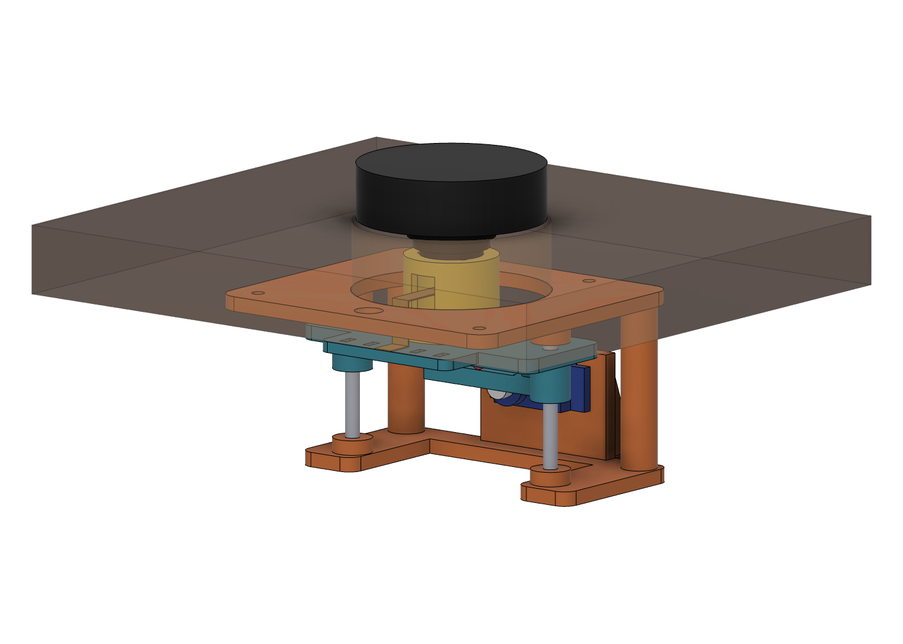
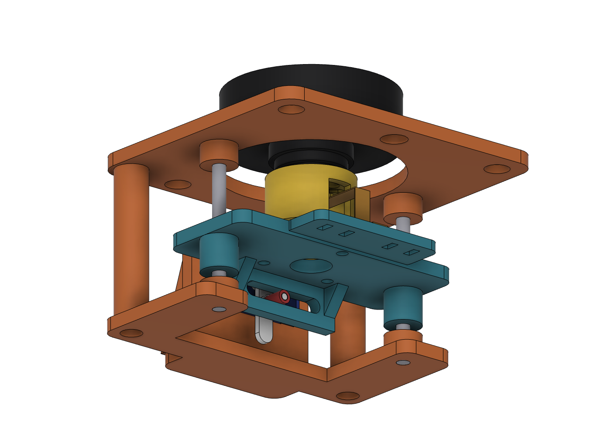

# Board lift: VIEWE 1.5" knob display in a wood panel

The display sits flush with the wood. When a hand comes close, it rises 16 mm so the whole
knob stands proud and can be turned or pressed. When the hand leaves, it lowers back to
flush.




## How it works

A micro servo turns a crank pin inside a horizontal slot on the carriage. This is a
Scotch yoke. Half a turn of the servo moves the carriage the full 16 mm.

- **Smooth by geometry.** Lift follows `r·(1 − cos θ)`, so even at a constant servo speed the
  board starts slowly, speeds up, then slows into each end. The firmware adds more easing on top.
- **Locked at both ends.** Flush and fully raised are both dead-centre positions, so pressing the
  knob pushes straight down the crank. Nothing can back-drive the servo. You can also stop sending
  servo pulses at rest, so there is no hum and no jitter.
- **Knob still works.** The carriage holds only the board's fixed rear boss, so the rotating shell
  and the push button keep working.

## Board data used

From VIEWE `UEDX46460015-MD50ET V2.0 SPEC.pdf`, p. 9:

- Shell: Ø51.7 ±0.5 mm, 15.23 mm deep. Front face to the bottom of the rear boss is 25.15 mm.
- Rear boss: three steps, Ø24.0 × 4.85, Ø20.9 × 3.0 and Ø17.4 × 2.07 mm.
- Fixing: 3× M2.5 at 120°, plus 2 locating pins of Ø2.0.

The drawing does not make clear which circle each set sits on. The two candidates are the
Ø12.10 and Ø15.03 PCDs. The adapter allows for both:

- The screw holes are radial slots that fit any PCD from 11 to 15.6 mm.
- Kidney-shaped reliefs clear the pins wherever they fall.

## Printed parts (`stl/`, already in print orientation, no supports)

| Part | Qty | Notes |
|---|---|---|
| `mount_plate.stl` | 1 | Glue face is on the bed. Its two pillars carry the base. |
| `base.stl` | 1 | Holds the rod feet and the servo wall. |
| `carriage.stl` | 1 | Printed bushings ride the rods. Has the yoke slot and a deck for the FPC adapter board. |
| `board_adapter.stl` | 1 | Its height depends on panel thickness (21.9 mm for 3/4"). |
| `pin_sleeve.stl` | 2 | 4 mm roller over the crank pin. Print a spare. |
| `glue_jig.stl` | 1 | Centres the mount plate on the bore while the glue cures. |

**Print settings:** PETG or PLA, 0.2 mm layers, 4 walls, 30% infill.

**Fits to test first:**

- Rod sockets and base holes are a 4.0 mm press fit. Ream with a 4.0 mm drill if they're too tight.
- Carriage bushings are 4.3 mm. They should slide freely. Add a drop of dry PTFE lube.

## Hardware

| Item | Qty |
|---|---|
| MG90S metal-gear micro servo. Any 23×12 mm micro with a 27.8 mm ear pitch fits; a quieter digital micro is a nice upgrade. | 1 |
| 4 mm steel rod, 50 mm long (cut from 4 mm stainless rod) | 2 |
| VL53L0X time-of-flight breakout (proximity) | 1 |
| 3.3 V regulator for the sensor (e.g. an AMS1117-3.3 or MCP1700 module), unless its I2C pull-ups go to 2.8 V | 1 |
| 10 kΩ resistor, servo signal to GND (keeps the servo quiet during boot) | 1 |
| M2.5×6 screws (board to adapter) | 3 |
| M3×8 screws (adapter to carriage, from below) | 3 |
| M3×10 screws (base to pillars, self-tapping into the pilots) | 2 |
| M2×12 screw and nut (crank pin through the horn) | 1 |
| #4 × 1/2" flat-head wood screws (optional, besides glue) | 4 |
| 5 V 2 A supply, plus a 470–1000 µF capacitor across the servo supply | 1 |
| 2-1/8" (54 mm) Forstner bit for the panel bore | – |

## Assembly

1. **Drill the panel.** Bore 2-1/8" through the panel, then make the sensor hole as described under
   [Mounting the sensor](#mounting-the-sensor).
2. **Glue the mount plate.** Put the glue jig, flange down, into the plate's bore. Push its top into
   the wood bore from behind, then glue the plate face to the panel. Epoxy or construction adhesive
   works better than PVA on plastic. Remove the jig once the glue has cured.
3. **Board to adapter.** Thread the FPC through the adapter's centre hole and out its side window.
   Screw 3× M2.5 from inside the adapter, through the radial slots, into the board's rear boss.
4. **Adapter to carriage.** Screw 3× M3×8 up from under the carriage. Zip-tie the FPC adapter board
   to the deck. On top of the deck it must be no taller than 7 mm, otherwise mount it underneath.
5. **Servo into the base.** Pass the servo body through the wall window from the slot side, ears
   against the wall, and fix it with the two servo screws.
6. **Join the frame.** Hold the carriage under the mount plate and bring the base up. Fix the base
   to the pillars with 2× M3×10. Push the two rods up from below: through the base, through the
   carriage bushings, and into the plate sockets.
7. **Fit the crank.** Put the M2×12 screw through the horn hole closest to 8 mm from the centre,
   head toward the servo. Tighten the nut on the other side and slide on a pin sleeve. If you like,
   cut off the arm beyond the pin.
   1. Command the servo to "up".
   2. Lift the carriage by hand to the top.
   3. Press the horn onto the spline pointing straight up, so the sleeve enters the slot.
   4. Fit the horn screw from the front, under the carriage.

   The fin also stops the horn from walking off the spline.
8. **Calibrate.** Follow [Calibrating the servo](#calibrating-the-servo). The board should then sit
   exactly flush at "down".

**If your horn hole is not 8 mm from the centre:** set `crank_r` to the real value and regenerate.
That changes the travel to 2 × `crank_r` and resizes the adapter so flush stays flush.

## Firmware (`firmware/board_lift/`)

An Arduino sketch for the ESP32-S3 on the board. It raises the board when a hand stays within
15 cm of the sensor for 150 ms. It lowers the board after 2.5 s with nothing within 25 cm.

- **Knob counts as presence.** Turning or pressing the knob keeps the board raised for 6 s.
  Pressing it while flush also raises it.
- **Smooth, reversible motion.** The planner works in board millimetres: limited acceleration,
  14 mm/s up and 10 mm/s down, then a smoothing filter. If a hand returns while the board is
  lowering, it turns around without a jolt.
- **Quiet at rest.** About 0.4 s after arriving, the servo pulses stop. The crank's dead centre
  holds the board.
- **Survives power cuts.** The resting end (up or down) is saved to flash. If power is cut while
  the board is raised, the next boot lowers it smoothly instead of snapping.

### Building

1. **Board package:** Arduino IDE with "esp32 by Espressif" 3.x installed.
2. **Library:** install **VL53L0X by Pololu** from the Library Manager.
3. **Board:** select **ESP32S3 Dev Module** and set:
   - **USB CDC On Boot: Enabled.** This is required: the sensor's SCL line uses GPIO43, which is
     UART0's TX pin. The sketch refuses to compile if this is left disabled.
   - Flash Size: 16MB, PSRAM: OPI PSRAM (same as VIEWE's examples).
4. **Open and upload:** open `firmware/board_lift/board_lift.ino` and upload over the adapter
   board's USB-C.
5. **Open the serial console** at 115200 baud and send `?` for the list of commands.

Every tunable setting is in `config.h`: pins, speeds, distances, hold times and the servo
defaults.

The motion planner and the proximity trigger don't depend on Arduino. `firmware/tests/test_logic.cpp`
unit-tests them on a computer:

```bash
cd firmware/tests && c++ -std=c++17 -I ../board_lift test_logic.cpp -o /tmp/test_logic && /tmp/test_logic
```

### Wiring (FPC adapter board)

| Signal | FPC pin | ESP32-S3 | Goes to |
|---|---|---|---|
| 5V | 1 | – | Servo +, 3.3 V regulator input |
| GND | 3 | – | Servo −, sensor GND, regulator GND |
| RX2 | 4 | GPIO40 | Sensor SDA |
| TX2 | 5 | GPIO39 | Servo signal (10 kΩ to GND) |
| TX1 | 7 | GPIO43 | Sensor SCL |

- **Don't run the sensor's I2C at 5 V.** Pololu and Adafruit breakouts pull SDA/SCL up to their
  VIN, and the ESP32's pins are not 5 V tolerant. Power the sensor from the 3.3 V regulator.
- **Capacitor:** put the 470–1000 µF capacitor across the servo's 5 V and GND, close to the servo.
  This stops servo start-up current from browning out the board.
- **Supply:** use 5 V 2 A.
- **Pin 2:** the spec calls it GPIO38, GPIO18 or "PB7" depending on the page. It is not used.

### Calibrating the servo

The two endpoints are the crank pointing straight down (bottom dead centre, board flush) and
straight up (top dead centre, board raised). Calibration moves the servo slowly, never in a jump.

1. **Bottom:** send `p 600`, then nudge with values like `p 580` or `p 620` until the crank points
   straight down. Send `b`.
2. **Top:** send `p 2400` and nudge the same way until the crank points straight up. Send `t`.
3. **Save:** send `w`. The endpoints are kept in flash.
4. **Test:** send `u` and `d` to try it, then `a` to go back to automatic mode.

**If the board sits slightly below flush at bottom dead centre:** raise `kZDownMm` in `config.h`.
For example, 0.3 stops 0.3 mm short of dead centre.

`s` prints the status, and `l` toggles a live log. Use the log to see what the sensor reads with
nothing above it.

### Mounting the sensor

**Don't mount the sensor at the bottom of a long hole.** The VL53L0X sees a 25° cone. At the bottom
of a 19 mm deep, Ø8 hole, the cone hits the hole's walls. The sensor then reports a constant short
distance, and the board would stay up forever.

1. **Sight hole:** drill a Ø8 hole through from the show face, at least 45 mm from the knob centre
   so the pocket in step 2 clears the 54 mm bore.
2. **Pocket:** from the back, drill a Forstner pocket wide enough for your breakout (25–30 mm). Stop
   about 3 mm short of the show face.
3. **Fit the sensor:** glue the breakout into the pocket with the sensor centred under the hole.
4. **Wires:** run the four wires to the adapter board, with enough slack for the 16 mm of travel.
   The mount plate's Ø8 window is not needed for this; use it as a wire pass-through if it helps.

With nothing above it, the live log should show `range=-1` (nothing in range) or the distance to the
ceiling. A steady small number means the cone is still clipping the hole walls.

**Avoid:** anything left sitting over the sensor (a mug, a phone) keeps the board raised.

### Using it inside your own UI sketch

The lift is self-contained: one sensor task, plus a 200 Hz control step in `loop()`. To merge it
with VIEWE's LVGL examples:

- **Knob pins:** set `kWatchKnobPins = false` so it leaves the encoder and button pins to
  `ESP_Knob`/`Button`. Call `noteKnobActivity()` from their callbacks instead.
- **UI hook:** put your display wake/sleep code in `onLiftState()`.
- **I2C:** the sensor uses I2C port 0 (`Wire`). The touch controller uses port 1, so they don't
  collide.

## Regenerating

`board_lift_gen.py` builds everything in a new Fusion design. To change it:

1. Edit `P` at the top (for example `panel_t` for a different panel, or `crank_r`).
2. Run the script from Fusion: Utilities → Scripts and Add-Ins.

The script builds the design, runs `interference()` and rewrites the STLs, STEP and F3D.
`interference()` checks every part, plus the reference board, servo, horn and rods, at several crank
angles. The current design reports no collisions from 0° to 180°.
