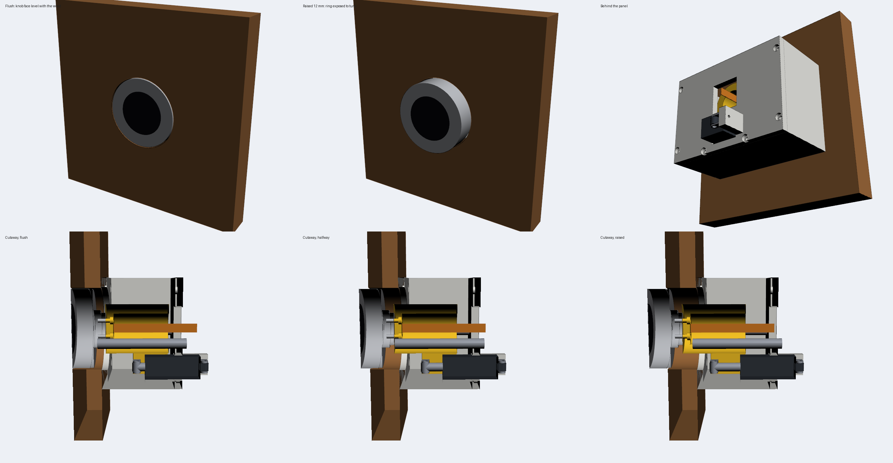

# Rising knob panel

A 3D-printed module that mounts a **VIEWE UEDX46460015-MD50ET** (ESP32-S3, 1.5" round 466×466 AMOLED knob display)
behind a wood panel. When a hand comes near, the knob glides **12 mm** out of the panel so its ring can be turned.
When the hand leaves, it sinks back **flush with the wood**.

**v3:** a pocket-size **Actuonix PQ12-R** linear actuator moves the knob.
- **v1** (hobby servo and crank) is in git history and in the [original chat](../chats/2026-10-24-autodesk-fusion-mcp-server-connection/).
- **v2** (NEMA 17 lead-screw stepper) is in git history.

**Nothing has been printed or tested on real hardware yet.**



## How it moves

- **Drive:** the **PQ12-R** (36.5 × 21.5 × 15 mm body, ~21 g, 20 mm stroke) pushes the carriage through a pin at
  each end.
- **Positioning:** its built-in controller holds whatever position a standard servo pulse asks for, so the ESP32
  just sends the position. There's no motor driver, homing or end-stop sensor.
- **Holds without power:** the gearbox resists 25 N of back-drive on the 63:1 version. Once parked, the firmware stops
  the signal and the actuator goes quiet.
- **Guides:** two **6 mm steel rods in LM6UU bearings**, held at both ends by the base and the rear plate, inside a
  U-shaped printed cage.
- **Gradual, no popping:** the firmware ramps the commanded position: speed up, cruise, slow down. Rising takes
  ~1.8 s and sinking ~2.5 s. If a hand returns while the knob is sinking, it slows, stops and rises again without a
  jolt. The actuator hums softly while moving (55 dB at 45 cm per the datasheet).
- **Stops:** at the back, the actuator's own full retraction. At the front, the carriage lands on the rod bosses
  just before the actuator's full extension. The firmware keeps it short of both.

### Which PQ12

| Model | Speed (no load) | Force | Holds against | Notes |
|---|---|---|---|---|
| **PQ12-63-6-R** (recommended) | 15 mm/s | 45 N | 25 N | Fast enough for the default ramp |
| PQ12-100-6-R | 10 mm/s | 50 N | 35 N | Holds harder; set `kRaiseSpeed`/`kLowerSpeed` to ~6/4 mm/s |
| PQ12-30-6-R | 28 mm/s | 18 N | 9 N | Not recommended: a firm press on the knob can push it back |

The `-R` (RC linear servo) version is rated 6 V. SparkFun reports it running on 5 V with a little less speed and
force, so it can share the board's 5 V supply. Each one ships with two U-brackets and M3 hardware; both are used here.

### Versions compared

| | v1 servo + crank | v2 stepper | **v3 PQ12-R** |
|---|---|---|---|
| Drive weight | ~13 g | ~300 g + driver board | **~21 g** |
| Electronics | servo | TMC2209, I²C expander, home sensor, 12 V | **just the actuator (1 signal pin, 5 V)** |
| Holds unpowered | at dead centres only | yes (lead screw) | **yes (25–35 N)** |
| Guides | 4 mm rods | 8 mm rods | **6 mm rods** |
| Positioning | servo deadband | 1/800 mm, homed | **±0.1 mm repeatable, absolute** |
| Module size behind the wood | 96 × 85 × ~51 mm | 108 × 98 × ~104 mm | **104 × 73 × ~72 mm** |

## Aligning the stop and start

Both stop positions are set in firmware, measured as the actuator's extension in mm:

- **Flush:** the extension that puts the knob face level with the wood. Default 3.0 mm, adjustable 1.5–8 mm in
  0.05 mm steps.
- **Height:** how far it rises above flush. Default 12 mm, adjustable in 0.1 mm steps.

To set them:
- Run `align` in the USB console, or hold the board's BOOT button for 2 s.
- **Flush step:** the knob drops to flush so you can see it against the wood. Type `+`/`-` (it stays flush while you
  nudge), or turn the ring. Turning the ring lifts the knob, because the ring can't be reached at flush; a second
  after you stop, it drops to show the new position.
- Press the button or type `next` for the **height** step. The knob follows the ring live.
- Press or type `next` again to save.
- You can also set values directly: `flush 3.20`, `height 12.5`.

The PQ12 repeats to ±0.1 mm and has 0.25 mm of backlash. The knob always comes down to flush from above, so the
backlash lands the same way every time.

## Print files

STLs are already in print orientation. Use PETG, 4 walls and 40% gyroid infill. No supports are needed.

| File | Size (mm) | Job |
|---|---|---|
| [`stl/base.stl`](stl/base.stl) | 104 × 73 × 48 | Glues/screws to the back of the wood: plate with the knob hole, front rod sockets, side walls and bottom wall |
| [`stl/rear_plate.stl`](stl/rear_plate.stl) | 104 × 73 × 24 | Bolts to the walls: rear rod sockets, a window the actuator passes through, and the post its rear bracket screws to |
| [`stl/carriage.stl`](stl/carriage.stl) | 89 × 48 × 41 | The knob screws to its front; two LM6UU press-fit bores and the lug the actuator's front bracket screws to. The FPC runs down the hollow middle |

[`rising_knob_assembly.step`](rising_knob_assembly.step) is the whole assembly (printed parts, knob, actuator,
brackets, rods, bearings and a wood panel), coloured, for opening in Fusion.

### Hardware

- 1× **Actuonix PQ12-63-6-R**. Its two U-brackets and M3 hardware are used for the pins.
- 2× **Ø6 mm steel rod, 51 mm** long, and 2× **LM6UU** linear bearings
- 1× **VL53L1X** distance sensor and a 3.3 V regulator for it (MCP1700-3302 or AMS1117-3.3)
- 1× 5 V 2 A power supply, a 470–1000 µF capacitor and a 10 kΩ resistor
- Screws:
  - 3× M2.5×6 (knob to carriage)
  - 2× M3×6 (U-brackets to the carriage lug and the rear post, self-tapping)
  - 6× M3×12 (rear plate to walls, self-tapping)
  - 4× #4 × ½" flat-head wood screws, or glue

Wiring is in the [firmware README](firmware/README.md#wiring).

### Assembly order

1. Press the LM6UU bearings into the carriage from the back, until they seat on the lip.
2. Screw the knob to the carriage (M2.5 screws from inside the tube). Feed the FPC through the slot and down the middle.
3. Screw one U-bracket to the side of the carriage's lug and the other to the post on the rear plate. Both open
   toward the actuator's axis.
4. Press the rods into the base sockets, slide the carriage on, and screw the rear plate onto the walls.
5. From behind, pass the actuator through the rear plate's window, rod first. Pin the rod end in the carriage's
   bracket and the rear tab in the post's bracket. Keep the pins snug but free to pivot, so the actuator never
   side-loads its rod.
6. Wire it up, then follow [Aligning the stop and start](#aligning-the-stop-and-start).

### Assumptions to check

- **Panel thickness:** 3/4" (19.05 mm). This is `T` at the top of `source/rising_knob.py`. A different thickness
  is also absorbed by the firmware's flush setting, within its 1.5–8 mm range.
- **Hole in the wood:** about 53 mm. A 2-1/8" (54 mm) Forstner bit works.
- **FPC length:** the knob's 60 mm ribbon only just clears the rear plate. Use a 10-pin, 0.5 mm FPC extension
  and leave a slack loop.
- **Fits:** the LM6UU bores are 12.15 mm (press fit) and the rod sockets 6.15 mm. Print the carriage first and test-fit.
- **PQ12 geometry:** modelled from the Actuonix datasheet (rev D): 42 mm between holes retracted, axis 5.5 mm from
  one edge, 3 mm pin holes. Check it against your unit before printing.

## Regenerating

The model is parametric [CadQuery](https://cadquery.readthedocs.io/) code. Change the parameters at the top of
[`source/rising_knob.py`](source/rising_knob.py) (panel thickness, rod spacing, flush extension, actuator position)
and rebuild:

```bash
uv venv --python 3.12 .venv
uv pip install --python .venv/bin/python cadquery pillow
cd source
../.venv/bin/python rising_knob.py check export ../stl   # clash check over the stroke + STL export
mv ../stl/rising_knob_assembly.step ..
../.venv/bin/python render.py ../renders                   # offscreen VTK previews (xvfb-run -a on headless Linux)
```

`check` intersects every part with every other part at each 1 mm of the stroke, from full retraction (−3 mm) to
the front stop (+16 mm). The last run reported **0 clashes**, and all three STLs are single watertight bodies.
Pushing the carriage 1 mm past either end does show overlaps, so the check does catch collisions.
